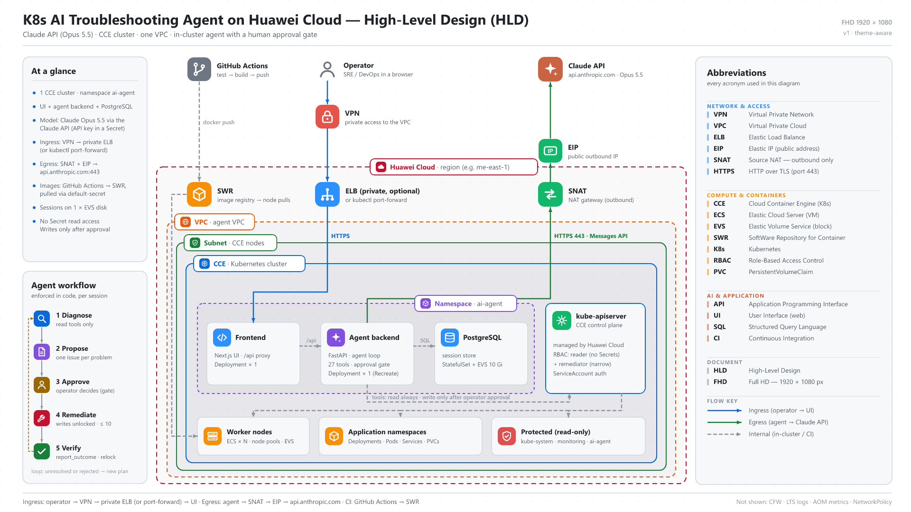

# Kubernetes AI Troubleshooting Agent — Claude API on Huawei Cloud CCE

An in-cluster agent that investigates Kubernetes problems in plain language, proposes a
fix, applies it **only after a human approves**, and verifies the result.

It follows the design described in DevOpsCube's
[*Build a Kubernetes AI Agent*](https://devopscube.com/build-kubernetes-ai-agent/)
(diagnose → propose → approve → remediate → verify, a FastAPI backend, a Next.js UI and
PostgreSQL session storage), re-implemented for:

| Original article | This project |
|---|---|
| Amazon Bedrock (Nova Pro) via boto3 | **Claude API** (`claude-opus-5-5`) via the official `anthropic` Python SDK |
| LangGraph / LangChain tool decorators | A small hand-written tool registry and agent loop (no framework) |
| Amazon EKS + EKS Pod Identity for model access | **Huawei Cloud CCE**; API key in a Kubernetes Secret |
| ECR / public images | **SWR** (SoftWare Repository for Container) + `default-secret` pull secret |
| EBS default StorageClass | **EVS** via Everest CSI (`csi-disk-topology`) |
| — | CCE-aware system prompt (SWR, Everest, ELB annotations, node pools) |

## High-Level Design

<picture>
  <source media="(prefers-color-scheme: dark)" srcset="docs/hld/hld-k8s-ai-agent-dark.png">
  
</picture>

Generated by [`docs/hld/hld-diagram.py`](docs/hld/hld-diagram.py) (edit the script, not the images).

**Project status:** [Milestones](docs/milestones.md) · [Open items](open-items.md)

## Architecture

```
 Browser ──► ai-agent-frontend (Next.js)  ──/api/* proxy──►  ai-agent-backend (FastAPI)
              port-forward or private ELB                     │  agent loop + approval gate
                                                              │  tools ──► Kubernetes API (ServiceAccount + RBAC)
                                                              │  Claude API ──► api.anthropic.com (HTTPS egress)
                                                              └► ai-agent-postgres (StatefulSet, EVS disk)
```

### Agent workflow (enforced in code)

```
diagnosis ──propose_remediation──► awaiting_approval ──approve──► remediation
   ▲                                     │                              │
   └──────── reject / guidance ──────────┘◄──────── report_outcome ─────┘
```

* **Diagnosis** — Claude calls read-only tools (in parallel where possible) until it has
  evidence for a root cause. If nothing needs changing it just answers.
* **Proposal** — Claude calls `propose_remediation` with one entry per issue (root cause,
  evidence, exact fix steps, risk). The loop **pauses**; the plan appears in the UI.
* **Approval** — you approve all or some issues, reject, or send guidance. Your decision
  becomes the result of the `propose_remediation` tool call.
* **Remediation** — write tools are unlocked *only now*, only for this approval, and only
  up to `MAX_WRITES_PER_APPROVAL` real (non dry-run) writes.
* **Verification** — Claude re-reads the resources and calls `report_outcome`, which
  locks the write tools again. If not resolved, it investigates and proposes again.

### Safety layers

1. **Approval gate in code** — every request carries the same tool list (good for prompt
   caching), but the runner refuses any write tool call unless the session is in an
   operator-approved remediation window. The prompt is not the safety boundary.
2. **Guards** (`agent-backend/app/tools/guards.py`) — protected namespaces (`kube-system`,
   `kube-public`, `kube-node-lease`, `monitoring` and the agent's own namespace); patches
   touching `privileged`, `hostNetwork`, `hostPath`, `serviceAccountName`, `capabilities`,
   etc. are rejected; Kubernetes/CCE-managed node labels can't be edited; the last
   schedulable node can't be cordoned; replica cap; optional image-registry allow-list.
3. **RBAC** — `ai-agent-reader` (get/list/watch, **no Secrets**) and `ai-agent-remediator`
   (only the verbs the write tools need). Delete the remediator binding and set
   `ENABLE_WRITE_TOOLS=false` for a read-only agent.
4. **Dry run** — every write tool accepts `dry_run=true` (server-side validation).
5. **Prompt-injection hygiene** — the system prompt tells Claude that logs, annotations and
   ConfigMaps are data, not instructions; writes still need your approval regardless.

> Note: the `pods: create` permission (used by `recreate_pod`) is powerful. For tighter
> scope, replace the remediator `ClusterRoleBinding` with `RoleBinding`s in the namespaces
> the agent may fix.

## Tools

**Read (14):** `cluster_overview`, `list_resources`, `get_resource`, `find_unhealthy_pods`,
`describe_pod`, `get_pod_logs`, `list_events`, `list_nodes`, `describe_node`,
`check_scheduling` (explains Pending pods node-by-node: selector, affinity, taints,
cordon, free CPU/memory), `check_service_endpoints`, `top_pods`, `top_nodes`,
`get_rollout_status`.

**Write (11):** `delete_pod`, `restart_workload`, `scale_workload`, `set_container_image`,
`set_container_resources`, `patch_resource`, `update_configmap`, `recreate_pod` (for bare
pods whose spec is immutable), `rollback_deployment`, `cordon_node`, `label_node`.

**Control (2):** `propose_remediation`, `report_outcome`.

## Repository layout

```
agent-backend/                 FastAPI + agent (Python 3.12)
  app/main.py                  HTTP API (sessions, decisions, retry, /healthz, /metrics)
  app/agent/runner.py          agent loop, approval gate, write window, tool execution
  app/agent/prompts.py         system prompt (CCE-aware, static for caching)
  app/tools/{read,write,control,guards,kube,registry}.py
  app/infra/claude.py          Claude API client (Anthropic SDK)
  app/infra/{store,usage,metrics,logging_config}.py
  tests/                       pytest suite (fake Claude client; no cluster needed)
agent-interface/               Next.js UI + /api proxy route
k8s/                           Kustomize base for CCE
  optional/                    private ELB Service, NetworkPolicies
  test-scenarios/              six deliberately broken workloads
  scripts/build-push.sh        build + push images to SWR
.github/workflows/             CI: test, build, push to SWR
docs/hld/                      HLD generator + rendered diagrams
docs/milestones.md             delivery milestones (M0–M6)
open-items.md                  open items to close before production
```

## Prerequisites

* A CCE cluster (v1.28+ recommended) and `kubectl` access to it
  (CCE console → cluster → *Connection Information* → download kubeconfig).
* **Outbound internet from the nodes** to `api.anthropic.com:443` (and to Docker Hub for
  the `postgres:16-alpine` image, or mirror it into SWR). On CCE this means a **NAT
  Gateway with an SNAT rule + EIP** for the node subnet, or EIPs on the nodes.
* A **Claude API key** from the Claude Console, from an organization in a supported region.
* An **SWR organization** and a long-term login command (SWR console → *Generate Login
  Command*).
* The **Everest** add-on (installed by default) for EVS volumes. Optional: **metrics-server**
  or *Cloud Native Cluster Monitoring* for `top_pods` / `top_nodes`.

## Deploy

```bash
# 1. Build and push images to SWR
export SWR_REGISTRY=swr.<region>.myhuaweicloud.com     # e.g. swr.me-east-1.myhuaweicloud.com
export SWR_ORG=<your-organization>
docker login -u '<region>@<AK>' -p '<login key>' "$SWR_REGISTRY"
k8s/scripts/build-push.sh                 # PLATFORM=linux/arm64 for Kunpeng node pools

# 2. Point the manifests at your images and cluster
cd k8s
sed -i "s#swr.REGION.myhuaweicloud.com/ORG#$SWR_REGISTRY/$SWR_ORG#" kustomization.yaml
sed -i "s/CLUSTER_NAME=my-cce-cluster/CLUSTER_NAME=<your-cluster-name>/" kustomization.yaml

# 3. Secrets (git-ignored)
cp secrets/anthropic.env.example secrets/anthropic.env   # put your API key in it
cp secrets/postgres.env.example  secrets/postgres.env
sed -i "s/REPLACE_WITH_A_LONG_RANDOM_ALPHANUMERIC_STRING/$(openssl rand -hex 24)/" secrets/postgres.env

# 4. Apply
kubectl apply -k .
kubectl -n ai-agent get pods -w           # backend, frontend, postgres-0 -> Running

# 5. Open the UI
kubectl -n ai-agent port-forward svc/ai-agent-frontend 3000:3000
# browse http://localhost:3000
```

If your region does not sell the **SAS** EVS type, change
`everest.io/disk-volume-type` in `k8s/postgres.yaml` to `SSD`, `GPSSD` or `ESSD`.

The namespace's `default-secret` (created by CCE) is used to pull from SWR. If pods show
`ImagePullBackOff` with an auth error, check that the secret exists in `ai-agent`
(`kubectl -n ai-agent get secret default-secret`); create it from the SWR login command
if it is missing.

To expose the UI on your network instead of port-forwarding, use a **private** ELB:
edit and apply `k8s/optional/frontend-elb.yaml`. The UI has no login of its own; do not
put it behind a public EIP without adding authentication.

## Try it

```bash
kubectl apply -f k8s/test-scenarios/broken-workloads.yaml
```

This creates namespace `agent-lab` with six failures: an unschedulable pod (`web-service`,
nodeSelector `type=web`), a bad image tag, a CrashLoop from a missing setting, an OOMKill,
a Service whose selector matches nothing, and a missing ConfigMap. Then ask the agent,
for example:

* *"Pod web-service in agent-lab is stuck Pending. Why?"*
* *"Find all unhealthy workloads in agent-lab and fix them."*

You will see each tool call (expandable), the reasoning summaries, a plan card with
per-issue checkboxes, and, after you approve, the changes and the verification. Token use
and estimated cost for the session are shown in the top bar.

Clean up: `kubectl delete namespace agent-lab`.

## Configuration

Set in `k8s/kustomization.yaml` (`configMapGenerator`):

| Variable | Default | Meaning |
|---|---|---|
| `CLAUDE_MODEL` | `claude-opus-5-5` | Model ID |
| `CLAUDE_EFFORT` | `high` | `low`/`medium`/`high`/`xhigh`/`max` — reasoning depth vs. token spend |
| `CLAUDE_MAX_TOKENS` | `16000` | Per-response output cap |
| `CLAUDE_FALLBACKS` | `default` | Server-side refusal fallback (`off` to disable) |
| `ENABLE_WRITE_TOOLS` | `true` | `false` = diagnosis only; plans then come with `kubectl` commands for you |
| `PROTECTED_NAMESPACES` | `kube-system,kube-public,kube-node-lease,monitoring` | Never modified (agent namespace is always added) |
| `MAX_WRITES_PER_APPROVAL` | `10` | Real writes allowed per approval |
| `MAX_REPLICAS` | `20` | Upper bound for `scale_workload` |
| `ALLOWED_IMAGE_REGISTRIES` | *(empty = any)* | e.g. `swr.me-east-1.myhuaweicloud.com/` |
| `AGENT_MAX_ITERATIONS` | `40` | Model turns per run before pausing |
| `PRICE_*_PER_MTOK` | Opus 5.5 list prices | Only for the UI cost estimate |

### Claude API details

* Messages API with client-side tools, **adaptive thinking** (always on for Opus 5.5) with
  `display: "summarized"` so reasoning summaries show in the UI, and `output_config.effort`.
* **Prompt caching** on the whole prefix: tools and system prompt are static and history
  is append-only, so each turn re-reads earlier context from cache (visible as "cache" in
  the top bar).
* **Server-side refusal fallback** (`fallbacks: "default"`, beta header
  `server-side-fallback-2026-07-01`): if a safety classifier declines a turn — possible
  with security-flavoured Kubernetes content — the API continues it on a fallback model
  in the same call. Set `CLAUDE_FALLBACKS=off` to disable.
* SDK retries (4) cover 429/5xx/network errors; failed runs show a **Retry** button.

## Local development

```bash
cd agent-backend
python -m venv .venv && . .venv/bin/activate
pip install -r requirements-dev.txt
python -m pytest -q                       # no cluster or API key needed
export ANTHROPIC_API_KEY=...              # uses your current kubeconfig context
uvicorn app.main:app --reload --port 8000

cd ../agent-interface
npm ci && BACKEND_URL=http://localhost:8000 npm run dev   # http://localhost:3000
```

Without `DATABASE_URL` the backend keeps sessions in memory.

## Operations

* `GET /metrics` (Prometheus): sessions, tool calls by tool/status, plan decisions,
  Claude requests/latency, tokens by type, estimated cost. The backend pod carries
  `prometheus.io/*` annotations for CCE's monitoring add-on.
* Logs are JSON on stdout (collect them with CCE's LTS log collection).
* Keep the backend at **1 replica** (`Recreate` strategy): runs execute in-process.

## Cleanup

```bash
kubectl delete -k k8s/        # also deletes the ai-agent namespace and its PVC
```
Deleting the PVC releases the EVS disk (check the EVS console for leftovers).
